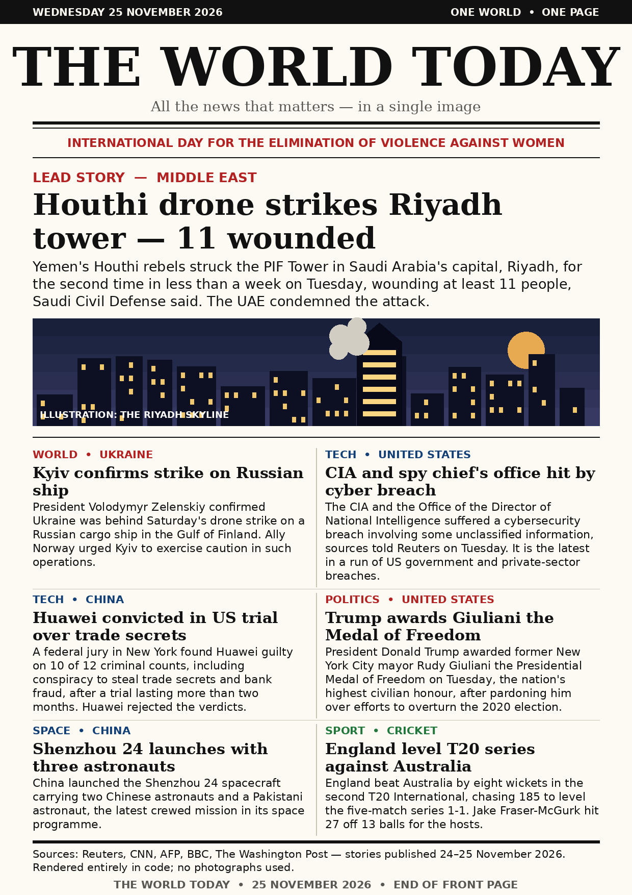

# The World Today — 25 November 2026

[](https://make.fun/bounty/news-image-20261125)
[](https://make.fun/bounty/news-image-20261125)
[](https://make.fun/bounty/news-image-20261125)

A one-image newspaper front page summing up **Wednesday 25 November 2026**'s
world news — rendered entirely in code with Python Pillow. No photographs,
no external assets: every glyph, rule and the skyline illustration is drawn
from code with system DejaVu fonts.



## Stories covered

All stories are real and were published 24–25 November 2026 (sources:
Reuters, CNN, AFP, BBC, The Washington Post).

| # | Story | Date |
|---|-------|------|
| 1 | **Lead:** Houthi drone strikes the PIF Tower in Riyadh — 11 wounded | 25 Nov 2026 |
| 2 | Zelenskiy confirms Ukraine's drone strike on a Russian ship in the Gulf of Finland | 25 Nov 2026 |
| 3 | CIA and the Office of the Director of National Intelligence hit by a cyber breach | 25 Nov 2026 |
| 4 | Huawei convicted in a US trial — guilty on 10 of 12 counts, incl. trade-secret theft | 24 Nov 2026 |
| 5 | Trump awards Rudy Giuliani the Presidential Medal of Freedom | 24 Nov 2026 |
| 6 | China launches Shenzhou 24 with two Chinese and one Pakistani astronaut | 24 Nov 2026 |
| 7 | England beat Australia by eight wickets in the 2nd T20I to level the series 1-1 | 24 Nov 2026 |

25 November is also the International Day for the Elimination of Violence
against Women, noted on the front page.

## How to render

```sh
python3 main.py   # writes entry.png (1240 x 1754, portrait)
```

Requires Python 3 and Pillow (`pip install pillow`). No network access is
needed at render time.

## Bounty

Built for the make.fun bounty
[news-image-20261125](https://make.fun/bounty/news-image-20261125) —
"Sum up 25 November's world news in one image", $100 prize pool
(1st $20, 2nd $12, 3rd $6, 4th–10th $2, 11th–50th $1.20).
Entries close 27 November 2026.

## License

MIT — see [LICENSE](LICENSE).
